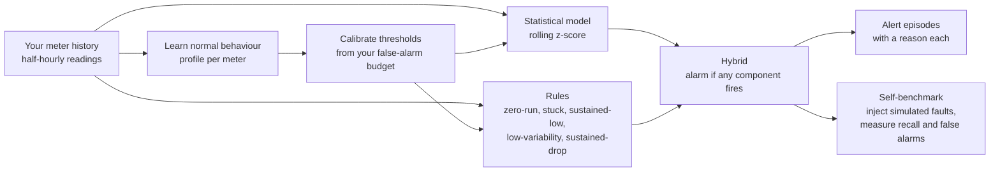

# GridGuard

**Find faulty or tampered smart meter readings, with plain-English reasons, on your own data.**

GridGuard learns what is normal for each of your meters, flags readings that look wrong, explains why, and tells you how much to trust its alerts on your data. It combines a statistical model with physics-informed rules, and every threshold is set from a false-alarm budget you choose.

**Live demo:** https://gridguard-xwkkhgjahunqyhwcsh6mbs.streamlit.app/

> Faults in all evaluations are **simulated**. GridGuard is decision support, not proof of theft: an alert means a meter's readings look unusual and deserve a check.

## What you can do with it

| Page | What it does |
|---|---|
| **Analyse your data** | Upload a half-hourly CSV (wide or long layout), check data quality, choose where "normal history" ends and a false-alarm budget, then get alert episodes with a reason for each, a plot per meter and a CSV download. |
| **Estimate accuracy** (same page) | GridGuard tests itself on *your* data: it learns from the earlier part, then checks the later part as-is (false alarms) and with simulated faults added (how many it catches, by fault type). |
| **Results** | The benchmark evidence: models vs rules vs hybrid, the false-alarm trade-off, the slow-fault rule comparison, example detections and limits. |
| **Demo dashboard** (home) | Hybrid detector output on 90 unseen London households with injected faults. |

**What makes it different**
- **You set the false-alarm budget** (alarm episodes per meter per week). Thresholds are calibrated on your own history, not on labelled faults.
- **It measures itself on your data**, so you see a recall and false-alarm estimate before trusting the alerts.
- **Every alert has a reason**: which rule fired, or that the statistical model found the pattern unusual.
- **Honest evidence**: leakage-free benchmark, several seeds, negative results reported.

## Why this matters

Modern grids rely on smart meters and sensors that report over networks. Tampered or faulty readings (energy theft, false data injection, sensor failures) can mislead operators and cause financial loss or instability. GridGuard asks a practical question: **can simple physics-informed rules catch the faults that statistical and deep learning models miss, without raising false alarms?**

**Short answer: yes.** On simulated faults, adding rules to a rolling z-score detector raised event recall from 33% to 78% with false alarms essentially unchanged (1.85 to 1.90 per meter-week). Zero-outs went from 0.3% detected to 96.7%, and flat-lines from 0.5% to 100%. A further multi-day rule then lifted drift and scale-down detection from about 12% and 17% to about 55% and 64% at a strict false-alarm budget.

## How it works



**Components** (`src/engine.py`, `src/rules.py`, `src/slow_rules.py`)
- *Rolling z-score:* flags readings far from the meter's own trailing 7-day behaviour.
- *Zero-run rule:* exact zero readings for a sustained period (at least 3 hours).
- *Stuck-reading rule:* the same non-zero value repeated.
- *Sustained-low rule:* over 6 hours, usage stays far below what is normal for that household at that time of day.
- *Low-variability rule:* over 6 hours, readings barely vary relative to the household's usual level.
- *Sustained-drop rule:* over 3 days, usage sits well below the household's normal level, scored relative to how much that meter's multi-day usage normally dips. Aimed at drift and scale-down.
- *Hybrid:* each component's score is divided by its own threshold, and an alarm is raised when any exceeds 1. Each episode is labelled with the most specific rule that fired.

**Calibration.** The statistical model gets the user's chosen false-alarm budget; each rule gets a budget of 0.05 alarm episodes per meter-week. Thresholds are the smallest values that meet the budget on the user's history, which is assumed to be mostly normal. The calibration table shows when a component could not meet its budget.

## Benchmark design

- Detectors learn normal behaviour from January to September and are tested on **90 unseen households** (210 used for fitting), from a 300-household sample of the London Smart Meters dataset for 2013.
- Faults are injected only in October to December. The **standard test set** has 540 faults (6 per meter): zero-out, flat-line, scale-down, spike and drift. The **hard test set** (4 per meter) has disguised variants: near-zero readings and flat readings with small jitter.
- Every threshold comes from clean training data only. No threshold is tuned on test data.
- Everything is repeated over **5 random seeds** (each changes the meter split and fault placement).
- Metrics: **event recall** (share of injected faults that trigger an alarm), **median delay** (hours from fault start to first alarm), **false alarms per meter-week**, and PR-AUC.

## Results

### Standard test set (mean over 5 seeds)

| Detector | Event recall | Median delay (h) | False alarms per meter-week | PR-AUC |
|---|---|---|---|---|
| Rolling z-score | 33.1% | 7.5 | 1.85 | 0.212 |
| Isolation Forest | 21.9% | 0.1 | 1.28 | 0.231 |
| Rules only | 45.4% | 2.8 | **0.06** | **0.447** |
| **Hybrid: z-score + rules** | **77.8%** | 2.9 | 1.90 | 0.397 |
| Hybrid: Isolation Forest + rules | 65.7% | 2.6 | 1.34 | 0.345 |

Event recall by fault type (standard set, mean over seeds):

| Detector | Drift | Flat-line | Scale-down | Spike | Zero-out |
|---|---|---|---|---|---|
| Rolling z-score | 67.1% | 0.5% | 48.3% | 62.4% | 0.3% |
| Isolation Forest | 38.4% | 6.3% | 10.0% | 55.2% | 0.2% |
| Rules only | 3.2% | **100%** | 5.5% | 1.3% | **96.7%** |
| **Hybrid: z-score + rules** | **69.0%** | **100%** | **51.6%** | **63.7%** | **96.7%** |
| Hybrid: Isolation Forest + rules | 40.8% | 100% | 15.1% | 56.4% | 96.7% |

**Findings**
1. **Statistical models and rules are complementary.** Models catch gradual and extreme changes but almost never catch zero-outs and flat-lines, even though those change the readings substantially. Rules do the opposite.
2. **Rules add recall without adding false alarms.** Rules alone cost about 0.06 false-alarm episodes per meter-week; the hybrid's false alarms come almost entirely from the statistical model.
3. **False alarms remain the main weakness at the default threshold** (about 1.9 per meter-week), which is why the budget is user-chosen.

### The false-alarm trade-off

Hybrid (z-score + rules), standard set, seed 42, varying the z-score threshold quantile:

| Z-score quantile | Event recall | False alarms per meter-week | Precision |
|---|---|---|---|
| 0.980 | 82.2% | 3.10 | 0.53 |
| 0.990 (default) | 75.0% | 1.83 | 0.63 |
| 0.995 | 67.2% | 1.12 | 0.69 |
| 0.999 | 56.1% | 0.32 | 0.76 |

### Slow faults: the sustained-drop rule

At a strict budget, drift and scale-down were the weak spot: short-window rules cannot see a meter that quietly reads 30 to 60% low for days. The sustained-drop rule was added and measured with GridGuard's self-benchmark on 40 households (learning from the earlier part of the year, testing on the later part, 3 simulated faults per meter, 3 seeds):

| False-alarm budget | Drop rule | All faults caught | Drift | Scale-down | Spike | False alarms on normal data |
|---|---|---|---|---|---|---|
| 0.25 | off | 50.8% | 12.0% | 16.7% | 34.1% | 0.257 |
| 0.25 | **on** | **69.2%** | **54.7%** | **63.6%** | 37.6% | 0.280 |
| 0.50 | off | 53.3% | 17.3% | 19.7% | 37.6% | 0.414 |
| 0.50 | **on** | **70.8%** | **57.3%** | **65.2%** | 41.2% | 0.428 |
| 1.00 | off | 61.4% | 38.7% | 30.3% | 44.7% | 0.753 |
| 1.00 | **on** | **75.6%** | **69.3%** | **68.2%** | 48.2% | 0.758 |

Zero-outs and flat-lines stay at 100% throughout. The rule was designed after seeing which faults the first detectors missed, with one setting (a 3-day window) and no tuning on these results.

<!-- HOLD-OUT RESULTS GO HERE -->

### Hard test set (mean over 5 seeds)

| Detector | Event recall | False alarms per meter-week |
|---|---|---|
| Rolling z-score | 0.2% | 2.09 |
| Isolation Forest | 0.9% | 1.50 |
| Rules only | 20.3% | 0.07 |
| Hybrid: z-score + rules | 20.5% | 2.15 |
| Hybrid: Isolation Forest + rules | 21.2% | 1.56 |

Disguised faults are mostly missed. Near-zero readings are partly caught by the sustained-low rule and jitter-flat faults almost never. Results vary a lot between seeds, so treat this set as a stress test, not a headline number.

### LSTM autoencoder (seed 42)

An LSTM autoencoder (one day of readings in, one day reconstructed) was trained on clean history, with its threshold set from held-out clean meters.

| Detector | Event recall | Median delay (h) | False alarms per meter-week | PR-AUC |
|---|---|---|---|---|
| Rolling z-score | 31.5% | 0.5 | 1.81 | 0.191 |
| Isolation Forest | 21.3% | 0.0 | 1.34 | 0.222 |
| LSTM autoencoder | 11.3% | 22.5 | 1.15 | 0.146 |

The LSTM did not beat the simple baselines, so the hybrids are built on the statistical baselines and the LSTM is reported as a negative result.


### Checks on the benchmark itself
- Automated tests cover labels, look-ahead leakage, a perfect detector scoring 100%, a random detector scoring at chance, the rules, the engine, the CSV loaders and the drop rule.
- Injected faults are visible: 98.3% change the readings by at least 10% of the household's usual usage.
- In the clean data, zero readings lasting 6 hours or more occur in about 5% of households (447 episodes, the longest about 126 days), probably vacant homes. This is a genuine false-alarm risk for any zero-run rule, which is why thresholds are calibrated on clean data.

## Mapping to MITRE ATT&CK for ICS (loose analogy)

| Fault type | Roughly corresponds to |
|---|---|
| Zero-out | Loss of View (T0829) |
| Flat-line, scale-down, drift | Manipulation of View (T0832) |
| Spike | Spoof Reporting Message (T0856) |

Smart meter faults are also ordinary energy theft and sensor failures, so this is an analogy for threat framing, not a claim that these are ICS attacks. Reference: https://attack.mitre.org/matrices/ics/

## Using it on your own data

**File format.** Half-hourly readings (15-minute data is summed to 30 minutes), at least about 5 weeks per meter (4 weeks of normal history plus some data to check). Either layout works:
- *Wide:* `timestamp, meter1, meter2, ...`
- *Long:* `timestamp, meter_id, kwh`

Up to 200 meters are used per upload. Day-first dates are supported.

**Privacy.** Uploaded data is processed in the app's memory for the session and GridGuard does not store it. The public demo is hosted on Streamlit Community Cloud, so do not upload confidential data there; run the app locally for private data.

## Run it yourself

```
git clone https://github.com/bilal-basheerai/Gridguard.git
cd Gridguard
python -m venv .venv
.venv\Scripts\activate
pip install -r requirements.txt
streamlit run app/app.py
```

Run the tests:

```
python -m pytest
```

Reproduce the research results (needs the dataset, see below):

```
python -m src.run_baselines
python -m src.run_lstm
python -m src.run_day4
python -m src.compare_drop_rule
python -m src.export_dashboard_data
```

Build the 2013 sample by running `notebooks/01_eda.ipynb` (written for Google Colab), which saves `data/meters_2013.parquet`.

## Project structure

```
src/        engine, rules, baselines, LSTM, simulators, evaluation, loaders, run scripts
app/        Streamlit app: home dashboard and pages (Analyse your data, Results)
notebooks/  exploration (01_eda.ipynb)
results/    result tables, figures, dashboard data, trained LSTM
tests/      harness, rules, engine, loaders and drop-rule tests
```

## Data

London Smart Meters dataset (half-hourly readings, 5,560 households, November 2011 to February 2014), in the version with missing values filled by carrying forward the last observation. Licensed CC BY 4.0.

> Godahewa, R., Bergmeir, C., Webb, G. (2020). *London Smart Meters Dataset (without Missing Values)* (Version 2) [Data set]. Zenodo. https://doi.org/10.5281/zenodo.3898331

Original source: Kaggle, "Smart meters in London" (https://www.kaggle.com/jeanmidev/smart-meters-in-london).

The 2013 sample is 300 households with complete readings for all of 2013 (17,520 readings each), chosen with a fixed random seed (42).

## Limitations

- Faults are **simulated**, not real attacks or real theft cases. Real tampering may look different.
- Residential data from one city.
- At the default threshold, false alarms are too high for practical use (about 1.9 per meter-week); the user-chosen budget trades them against recall.
- Disguised faults (hard set) and spikes are only weakly detected.
- The sustained-drop rule was designed after seeing which faults earlier detectors missed.
- The rules cover zero, stuck, very low, low-variability and sustained-drop patterns only. There are no weather-aware or capacity-limit rules.
- Calibration assumes the history period is mostly normal. Real faults or long vacancies inside it make GridGuard less sensitive.
- Some rule thresholds can end up at their strictest setting when a budget cannot be met; the calibration table shows this.
- GridGuard is decision support, not proof of theft.