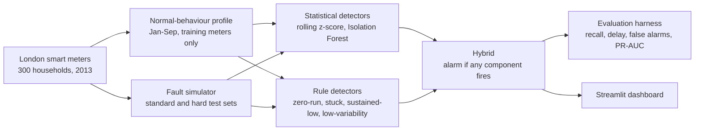
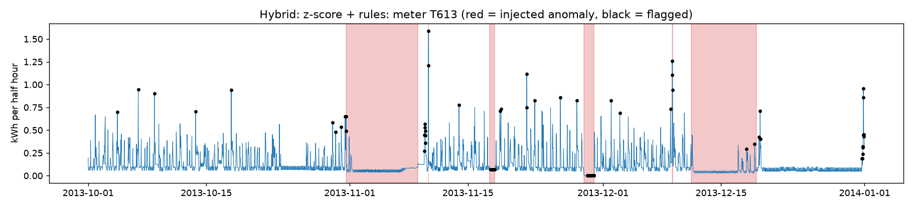

# GridGuard

AI-based anomaly detection for smart meter data, with physics-informed rules. A portfolio project at the intersection of renewable energy, machine learning and cybersecurity.

**Live demo:** https://gridguard-xwkkhgjahunqyhwcsh6mbs.streamlit.app/

**Status:** complete. Detectors, evaluation, hybrid, tests and dashboard are all built.

## Why this matters

Modern grids rely on smart meters and sensors that report over networks. Tampered or faulty readings (energy theft, false data injection, sensor failures) can mislead operators and cause financial loss or instability. GridGuard asks a practical question: **can simple physics-informed rules catch the faults that statistical and deep learning models miss, without raising false alarms?**

**Short answer:** yes. On simulated faults, adding four rules to a rolling z-score detector raised event recall from 33% to 78% while false alarms stayed essentially unchanged (1.85 to 1.90 per meter-week). Zero-outs went from 0.3% detected to 96.7%, and flat-lines from 0.5% to 100%.

## Data

London Smart Meters dataset (half-hourly readings, 5,560 households), from Zenodo: https://zenodo.org/records/3898331 (originally from Kaggle).

Sample used: 300 households with complete readings for all of 2013 (17,520 readings each), chosen with a fixed random seed (42).

## Method



**Benchmark design**
- Detectors learn normal behaviour from January to September and are tested on **90 unseen households** (210 used for fitting).
- Faults are injected only in October to December. The **standard test set** has 540 faults (6 per meter): zero-out, flat-line, scale-down, spike and drift. The **hard test set** (4 per meter) has disguised variants: near-zero readings and flat readings with small jitter.
- Every threshold comes from clean training data only. Statistical detectors use the 99th percentile of their clean scores. Each rule is set so it raises at most 0.05 false-alarm episodes per meter-week on clean data. No threshold is tuned on test data.
- Everything is repeated over **5 random seeds** (each changes the meter split and fault placement).
- Metrics: **event recall** (share of injected faults that trigger an alarm), **median delay** (hours from fault start to first alarm), **false alarms per meter-week**, and PR-AUC.

**Detectors**
- *Rolling z-score* and *Isolation Forest*: statistical baselines that score readings one at a time.
- *LSTM autoencoder*: reconstructs one day of readings; reported separately (Day 3).
- *Four rules* (`src/rules.py`):
  - **Zero-run:** exact zero readings for a sustained period (at least 3 hours).
  - **Stuck-reading:** the same non-zero value repeated.
  - **Sustained-low:** over 6 hours, usage stays far below what is normal for that household at that time of day.
  - **Low-variability:** over 6 hours, readings barely vary relative to the household's usual level.
- *Hybrid:* each detector's score is divided by its own threshold, and an alarm is raised when any component exceeds 1.

## Results

### Standard test set (mean over 5 seeds)

| Detector | Event recall | Median delay (h) | False alarms per meter-week | PR-AUC |
|---|---|---|---|---|
| Rolling z-score | 33.1% | 7.5 | 1.85 | 0.212 |
| Isolation Forest | 21.9% | 0.1 | 1.28 | 0.231 |
| Rules only | 45.4% | 2.8 | **0.06** | **0.447** |
| **Hybrid: z-score + rules** | **77.8%** | 2.9 | 1.90 | 0.397 |
| Hybrid: Isolation Forest + rules | 65.7% | 2.6 | 1.34 | 0.345 |

Event recall by fault type (standard set, mean over seeds):

| Detector | Drift | Flat-line | Scale-down | Spike | Zero-out |
|---|---|---|---|---|---|
| Rolling z-score | 67.1% | 0.5% | 48.3% | 62.4% | 0.3% |
| Isolation Forest | 38.4% | 6.3% | 10.0% | 55.2% | 0.2% |
| Rules only | 3.2% | **100%** | 5.5% | 1.3% | **96.7%** |
| **Hybrid: z-score + rules** | **69.0%** | **100%** | **51.6%** | **63.7%** | **96.7%** |
| Hybrid: Isolation Forest + rules | 40.8% | 100% | 15.1% | 56.4% | 96.7% |

**Findings**
1. **The two kinds of detector are complementary.** Statistical models catch gradual and extreme changes (drift, spikes, scale-downs) but almost never catch zero-outs and flat-lines, even though those change the readings substantially. Rules do the opposite. Combining them gives the best of both.
2. **Rules add recall without adding false alarms.** The rules alone cost about 0.06 false-alarm episodes per meter-week. The hybrid's false alarms are almost entirely the statistical component's own.
3. **False alarms remain the main weakness.** About 1.9 per meter-week is too many for practical use, and nearly all of it comes from the statistical model.

### False-alarm budget sweep

Moving the z-score threshold trades recall for fewer false alarms (hybrid z-score + rules, standard set, seed 42):

| Z-score quantile | Event recall | False alarms per meter-week | Precision |
|---|---|---|---|
| 0.980 | 82.2% | 3.10 | 0.53 |
| 0.990 (default) | 75.0% | 1.83 | 0.63 |
| 0.995 | 67.2% | 1.12 | 0.69 |
| 0.999 | 56.1% | 0.32 | 0.76 |

At the strictest setting the hybrid still detects more events (56.1%) than the z-score alone at its default (31.5% on this seed), with about one fifth of the false alarms.

### Hard test set (mean over 5 seeds)

| Detector | Event recall | False alarms per meter-week |
|---|---|---|
| Rolling z-score | 0.2% | 2.09 |
| Isolation Forest | 0.9% | 1.50 |
| Rules only | 20.3% | 0.07 |
| Hybrid: z-score + rules | 20.5% | 2.15 |
| Hybrid: Isolation Forest + rules | 21.2% | 1.56 |

Disguised faults are mostly missed. Near-zero readings are partly caught by the sustained-low rule (about 37% recall for rules only) and jitter-flat faults almost never (about 1 to 3%). Results vary a lot between seeds (standard deviation about 0.2 on event recall), so treat this set as a stress test, not a headline number.

### LSTM autoencoder (Day 3, seed 42)

An LSTM autoencoder (one day of readings in, one day reconstructed) was trained on clean history, with its threshold set from held-out clean meters.

| Detector | Event recall | Median delay (h) | False alarms per meter-week | PR-AUC |
|---|---|---|---|---|
| Rolling z-score | 31.5% | 0.5 | 1.81 | 0.191 |
| Isolation Forest | 21.3% | 0.0 | 1.34 | 0.222 |
| LSTM autoencoder | 11.3% | 22.5 | 1.15 | 0.146 |

The LSTM did not beat the simple baselines (drift 40.0%, spike 5.1%, scale-down 18.3%, flat-line 11.6%, zero-out 0.0% event recall), so the hybrids are built on the two baselines and the LSTM is reported as a negative result.



### Checks on the benchmark itself
- Automated tests pass (labels match injected changes, no look-ahead, a perfect detector scores 100%, a random detector scores at chance, rule behaviour).
- Injected faults are visible: 98.3% change the readings by at least 10% of the household's usual usage.
- In the clean data, zero readings lasting 6 hours or more occur in about 5% of households (447 episodes, the longest about 126 days), probably vacant homes. This is a genuine false-alarm risk for any zero-run rule, which is why rule thresholds are calibrated on clean data.

## Mapping to MITRE ATT&CK for ICS (loose analogy)

| Fault type | Roughly corresponds to |
|---|---|
| Zero-out | Loss of View (T0829) |
| Flat-line, scale-down, drift | Manipulation of View (T0832) |
| Spike | Spoof Reporting Message (T0856) |

Smart meter faults are also ordinary energy theft and sensor failures, so this is an analogy for threat framing, not a claim that these are ICS attacks. Reference: https://attack.mitre.org/matrices/ics/

## Dashboard

`app/app.py` is a Streamlit app that reads precomputed hybrid output (`results/dashboard_data.parquet`, standard test set, seed 42). Choose a meter, see its readings with alerts highlighted, and see each alert episode with its reason (which rule fired, or the model) and whether it matched an injected fault. Tick "Show injected faults" to compare alerts against ground truth.

## Project structure

```
src/        data loading, features, simulators, baselines, rules, LSTM, evaluation, run scripts
notebooks/  exploration (01_eda.ipynb)
app/        Streamlit dashboard
results/    result tables, figures, dashboard data, trained LSTM
tests/      harness and rule tests
```

## Setup

```
git clone https://github.com/bilal-basheerai/Gridguard.git
cd Gridguard
python -m venv .venv
.venv\Scripts\activate
pip install -r requirements.txt
```

Download the dataset from Zenodo, then run `notebooks/01_eda.ipynb` (written for Google Colab) to build the 300-household sample and save it as `data/meters_2013.parquet`.

Reproduce the results:

```
python -m src.run_baselines
python -m src.run_lstm
python -m src.run_day4
python -m src.export_dashboard_data
pytest
streamlit run app/app.py
```

## Limitations

- Faults are simulated, not real attacks or real theft cases. Real tampering may look different.
- Residential data from one city and one year.
- False alarms are still too high for practical use (about 1.9 per meter-week at the default threshold), driven by the statistical component.
- Disguised faults (hard set) are mostly missed.
- The rules cover only zero, stuck, very low and low-variability patterns. There are no weather-aware or capacity-limit rules.
- Rule thresholds are calibrated per seed to a fixed false-alarm budget, and in some seeds a rule's threshold ends up so strict that it never fires.
- The dashboard shows one seed of one test set, precomputed.
