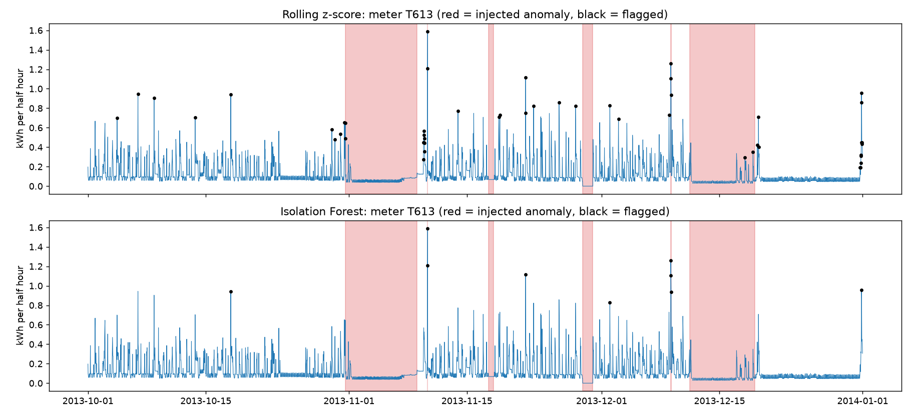

# GridGuard [Day 1]

AI-based anomaly detection for smart meter data, with physics-informed checks. A portfolio project at the intersection of renewable energy, machine learning and cybersecurity.

**Status:** work in progress. Day 1 of 5 complete (data pipeline and exploration).

## Why this matters

Modern grids rely on smart meters and sensors that report over networks. Tampered or faulty readings (energy theft, false data injection, sensor failures) can mislead operators and cause financial loss or instability. GridGuard explores how to detect such readings automatically, and whether physics-based rules can reduce false alarms compared with a purely statistical model.

## Data

London Smart Meters dataset (half-hourly readings, 5,560 households), from Zenodo: https://zenodo.org/records/3898331 (originally from Kaggle).

Sample used: 300 households with complete readings for all of 2013 (17,520 readings each), chosen with a fixed random seed (42).

## Plan

- [x] Day 1: environment, data pipeline, exploratory analysis
- [ ] Day 2: anomaly simulator, baseline detectors (rolling z-score, Isolation Forest), evaluation harness
- [ ] Day 3: LSTM autoencoder detector
- [ ] Day 4: physics-informed rules, hybrid detector, ablation study, explainability
- [ ] Day 5: Streamlit dashboard, write-up, demo

## Results so far: baseline detectors (Day 2)

Setup: detectors are fitted on 210 households and tested on 90 unseen households. Normal behaviour is learned from January to September; 540 synthetic anomalies (6 per meter) are injected only in October to December. Each detector's alarm threshold is the 99th percentile of its scores on clean training data, so every detector has the same false-alarm budget and no labels are used for tuning.

| Detector | Event recall | Median delay (h) | False alarms per meter-week | PR-AUC |
|---|---|---|---|---|
| Rolling z-score | 31.5% | 0.5 | 1.81 | 0.191 |
| Isolation Forest | 21.3% | 0.0 | 1.34 | 0.222 |

Event recall by anomaly type:

| Anomaly type | Events | Rolling z-score | Isolation Forest |
|---|---|---|---|
| Drift | 55 | 67.3% | 40.0% |
| Spike | 137 | 62.8% | 49.6% |
| Scale-down | 93 | 48.4% | 15.1% |
| Flat-line | 129 | 1.6% | 8.5% |
| Zero-out | 126 | 0.0% | 0.0% |

Finding: both baselines catch gradual and extreme changes but are almost blind to zero-outs and flat-lines, because a single zero or constant reading looks normal (zero is common at night). Detecting these needs evidence accumulated over hours. The LSTM autoencoder (Day 3) and physics-based rules (Day 4) target exactly these cases.


## Project structure

```
src/        data loading and feature code
notebooks/  exploration (01_eda.ipynb)
app/        dashboard (coming)
tests/
```

## Setup

```
git clone https://github.com/bilal-basheerai/Gridguard.git
cd Gridguard
python -m venv .venv
.venv\Scripts\activate
pip install -r requirements.txt
```

Download the dataset from Zenodo, then run `notebooks/01_eda.ipynb` (written for Google Colab) to build the 300-household sample and save it as `data/meters_2013.parquet`.

## Limitations

- Anomalies are simulated, not real attacks.
- Residential data from one city and one year.